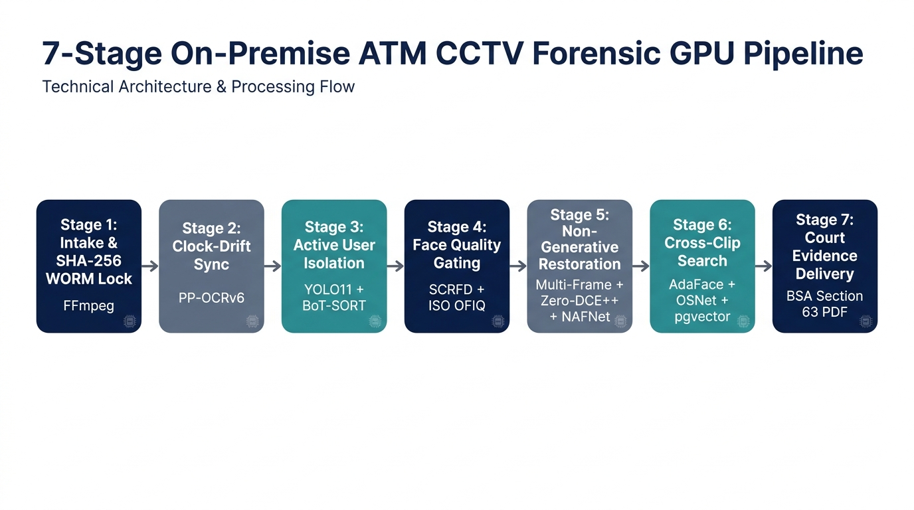
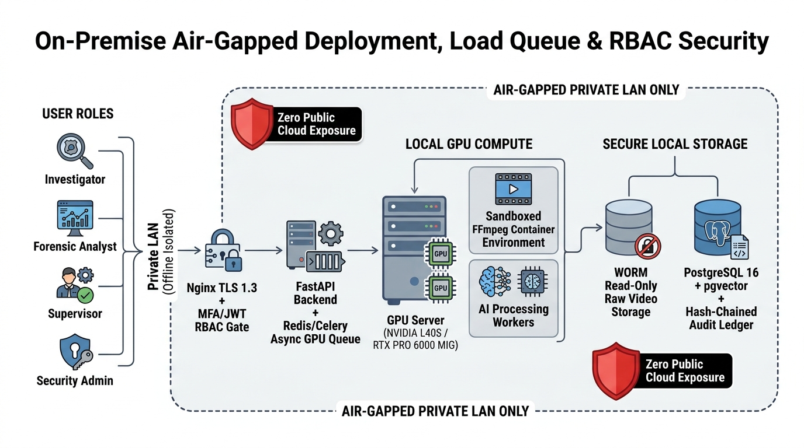
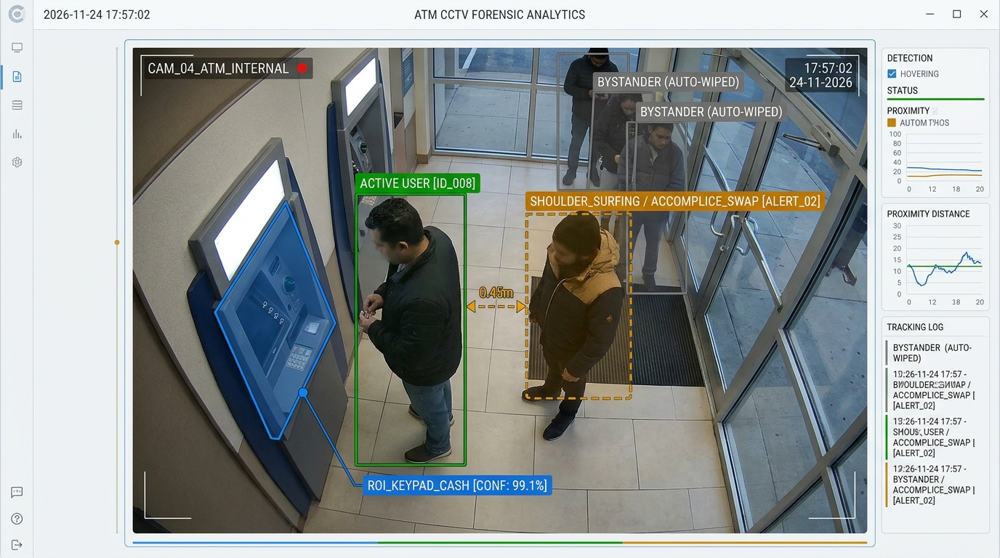
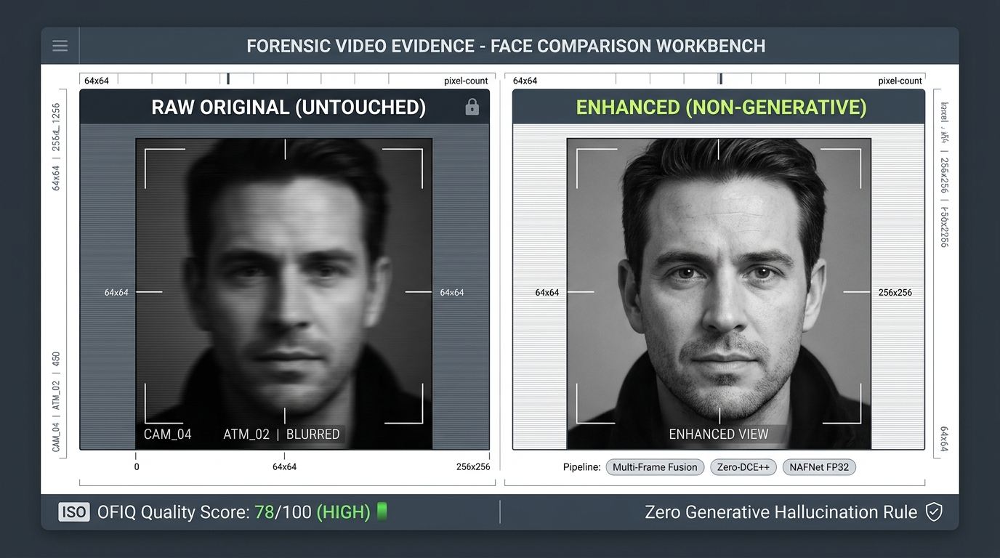
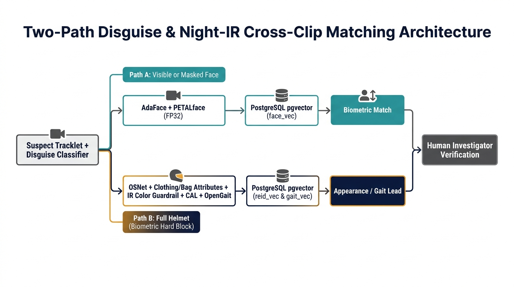
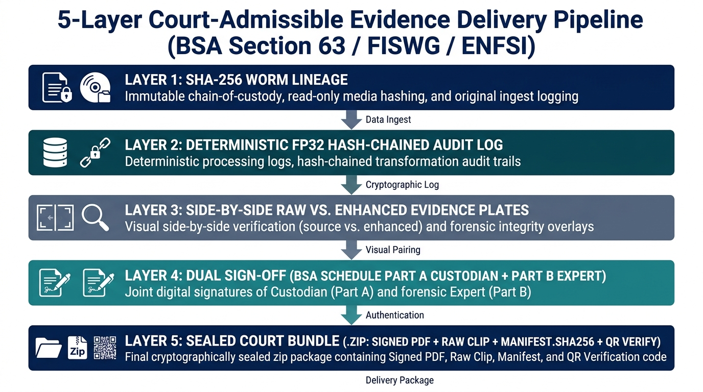

# On-Premise ATM CCTV Forensic Video-Analytics Engine
**Rajasthan Police Cyber Security Hackathon 2026 — Problem Statement PS04**  
*ATM CCTV Suspect Face Extraction for Card & ATM Fraud Investigation*

> **Zero Public Cloud Exposure • Zero Generative AI Hallucination • Court-Admissible under BSA 2023 Section 63 (Part A & Part B), FISWG & ENFSI**

---

## Live Interactive HTML Prototype (GitHub Pages)
Open [`prototype/index.html`](prototype/index.html) locally or enable GitHub Pages on this repository (`Settings → Pages → Branch: main / root`) to launch the **4-Module Investigator Web Workbench** featuring:
- Interactive **4-Role RBAC Switcher** (Investigator, Forensic Analyst, Supervisor, Security Admin)
- Client-side **SHA-256 WORM Intake Hashing** & **PP-OCRv6 Clock-Drift / Activity-Only Reel** controls
- **Active User Isolation**, **Shoulder-Surfing / Accomplice Swap** alerts & **ISO/IEC 29794-5 (OFIQ)** usability badges
- **Side-by-Side Raw vs. Non-Generative Enhanced** workbench (`Multi-Frame + Zero-DCE++ + NAFNet FP32`)
- **Two-Path Disguise & Night-IR Cross-Clip Router** + Live **Hash-Chained Audit Ledger** & **BSA Section 63 `manifest.sha256`** export

---

## 1. 7-Stage On-Premise GPU Forensic Pipeline



| Stage | Objective | Locked Models / Tools | Precision & Forensic Guardrail |
| :--- | :--- | :--- | :--- |
| **Stage 1: Intake, Hashing & DVR Normalization** | Lock raw evidence and unpack proprietary/VFR DVR exports | `SHA-256` + `FFprobe` + `FFmpeg` (`-c copy` rewrap → raw H.264/H.265 NAL carving → DVR Export SOP) | Write-Once Read-Only (**WORM**) storage; sandboxed non-root/no-network FFmpeg container |
| **Stage 2: Transaction Linking & Clock-Drift Sync** | Align bank withdrawal timestamp (`T_txn`) to drifted DVR clocks | **PP-OCRv6** (PaddleOCR v3.7 dot-matrix OSD) + **Activity-Only Reel** fallback | Explicit `CLOCK_SYNC_MODE` (`OSD_VERIFIED` / `MANUAL_OVERRIDE` / `ACTIVITY_REEL_MATCHED`) logged for court |
| **Stage 3: Room Geometry & Active User Isolation** | Isolate active cardholder, wipe bystanders, flag accomplices | **YOLO-World / YOLOE** (auto `ROI_KEYPAD_CASH`) + **YOLO11 + BoT-SORT** + OpenCV Fisheye | TensorRT **FP16**; per-tracklet `is_ir_night` check; untouched raw crop saved **before** optional fisheye undistortion |
| **Stage 4: Face Detection & ISO Quality Gating** | Scan full booth visit and score every face crop objectively | **SCRFD** (5-pt landmarks) + **OFIQ** (ISO/IEC 29794-5, 20+ metrics) | TensorRT **FP16**; maps 0–100 score to **High / Medium / Low** usability badges; top 5–10 frames |
| **Stage 5: Disguise Tagging & Non-Generative Restoration** | Classify occlusions/clothing and restore signal without inventing features | **PaddleClas PULC / SigLIP** + Pose-Gated **Multi-Frame Fusion** (≤5° yaw/pitch) + **Zero-DCE++** + **NAFNet** | Strictly **FP32** on `256×256` face crops only; **zero generative AI**; stamped `ENHANCED (NON-GENERATIVE)` |
| **Stage 6: Two-Path Disguise & Night-IR Search** | Cross-clip matching across ATM branches without false helmet hits | **Path A:** `AdaFace + PETALface` (FP32) • **Path B:** `OSNet + Attributes + IR Color Guardrail (VI-ReID) + CAL/OC4-ReID + OpenGait` | Segregated `pgvector 0.8+` HNSW columns (`face_vec`, `reid_vec`, `gait_vec`) with `iterative_scan = relaxed_order`; flags `INSUFFICIENT_BIOMETRIC_EVIDENCE` when physical cues are absent |
| **Stage 7: Court-Admissible Evidence Delivery** | Compile reproducible, tamper-evident courtroom export bundle | **FastAPI RBAC** + PostgreSQL Hash-Chained Audit Ledger + **WeasyPrint / ReportLab** | Sealed `.zip`: Signed **BSA Sec 63 (Part A & Part B) / FISWG / ENFSI** PDF + raw clip + plates + `manifest.sha256` + QR digest |

---

## 2. Visual System Architecture

### On-Premise Air-Gapped Deployment, Load Queue & RBAC Security


### Active User Isolation (`ROI_KEYPAD_CASH`), Shoulder-Surfing & Bystander Auto-Wipe


### Side-by-Side Raw Original vs. Non-Generative Enhanced Workbench


### Two-Path Disguise & Night-IR Cross-Clip Matching Architecture


### 5-Layer Court-Admissible Evidence Delivery Pipeline (BSA Section 63 / FISWG / ENFSI)


---

## 3. Infrastructure, GPU Sizing & Latency Benchmarks

### Hardware Tiers (Single Docker Compose Codebase)
| Deployment Tier | Recommended NVIDIA GPU | Target Workload |
| :--- | :--- | :--- |
| **Prototype / Local Cyber-Cell Desk** | **RTX 4060 Ti (16 GB)** or **RTX 5060 Ti (16 GB)** | Single-investigator air-gapped desk; holds full pipeline with zero OOM |
| **Multi-Officer Station Server (5–15 Users)** | **NVIDIA L40S (48 GB GDDR6 ECC, 350W)** | Concurrent CV/video analytics + FastAPI + Redis/Celery queue |
| **Regional HQ High-Load Server (20+ Users)** | **NVIDIA RTX PRO 6000 Blackwell Server Edition (96 GB GDDR7 ECC)** | 4× hardware **NVDEC** decoders + up to **4× 24 GB MIG** isolated workers |

### Latency Budget (10-Min 1080p @ 15 FPS Clip, 4-Min Window, 45-Sec Withdrawal)
- **Automated Background Run (Stages 1–6 via Celery GPU Queue):** **~14–22 s** (RTX 4060 Ti) | **~8–13 s** (NVIDIA L40S)
- **Full 1-Hour Activity-Only Reel Scan (Extreme Clock Drift):** **~18–30 s** (NVIDIA L40S @ 2 FPS NVDEC + TensorRT FP16)
- **Interactive Cross-Clip Search (100K–1M tracklets, `pgvector 0.8+`):** **< 150 ms** (15–45 ms DB query)
- **On-Demand Raw vs. Enhanced Crop Toggle (NAFNet FP32 `256×256`):** **120–250 ms**
- **Human Confirm / Reject Lead + Hash-Chained Audit Write:** **< 40 ms**
- **Sealed BSA Section 63 PDF + `manifest.sha256` `.zip` Bundle:** **1.5–3.0 s**

---

## 4. Database Architecture & 3-Tier Data Lifecycle
- **Why PostgreSQL 16 + `pgvector 0.8+`:** Keeps case records, 4-role RBAC, hash-chained BSA Section 63 audit logs, and segregated HNSW embeddings (`face_vec`, `reid_vec`, `gait_vec`) inside one offline **ACID-compliant database** with zero dual-DB sync drift. Above 10M tracklets (national scale), the modular storage layer scales vector indexing out to self-hosted **Qdrant** while keeping PostgreSQL as the legal system of record.
- **3-Tier Data Lifecycle:**
  1. **Immediate Auto-Wipe:** Temporary decode buffers and non-suspect **bystander** faces are deleted automatically after job completion.
  2. **Legal Retention:** Untouched raw CCTV footage stays locked on **WORM disk**; lightweight embeddings and hash-chained logs stay in PostgreSQL for cross-clip search and court re-verification.
  3. **Controlled Purge & Single-Clip Mode:** Closed cases undergo a Supervisor + Admin logged **Retention Purge**; an optional *"Do Not Index in Cross-Clip DB"* toggle supports isolated single-clip analysis.

---

## 5. Locked REST & WebSocket API Contract (`backend/main.py`)

| Method & Endpoint | Allowed Roles | Mode | Function |
| :--- | :--- | :--- | :--- |
| `POST /api/v1/auth/login` | All 4 Roles | Sync | Credentials + MFA OTP → role-scoped JWT |
| `POST /api/v1/cases/{case_id}/clips` | Investigator, Analyst | **Async (202)** | Sandboxed intake, WORM SHA-256 lock, queues GPU job |
| `WS /api/v1/jobs/{job_id}/stream` | Investigator, Analyst | Stream | Live stage progress (Stages 1–6) & drift/DVR alerts |
| `PATCH /api/v1/clips/{clip_id}/calibration` | Forensic Analyst | Sync | Override `ROI_KEYPAD_CASH`, clock drift, or fisheye toggle |
| `GET /api/v1/clips/{clip_id}/suspects` | Investigator, Analyst, Supervisor | Sync | Returns `ACTIVE_USER`, accomplice flags & OFIQ gallery |
| `POST /api/v1/frames/{frame_id}/enhance` | Investigator, Analyst | Sync | On-demand Multi-Frame + Zero-DCE++ + NAFNet (FP32) |
| `POST /api/v1/search/cross-clip` | Investigator, Analyst | Sync | Two-Path router (AdaFace/PETALface vs OSNet/VI-ReID/CAL/OpenGait) |
| `POST /api/v1/cases/{case_id}/leads/{lead_id}/verify` | Investigator, Analyst | Sync | Human-in-the-loop Confirm / Reject + audit log entry |
| `POST /api/v1/cases/{case_id}/approve-export` | Supervisor | **Async (202)** | Co-signs Part B & seals BSA Sec 63 PDF + `.zip` bundle |
| `GET /api/v1/audit/verify-chain/{case_id}` | Supervisor, Security Admin | Sync | Recomputes cryptographic hash chain (`prev_hash → curr_hash`) |

---

## 6. Quick Start in VS Code (Local On-Premise Run)

```bash
# 1. Inspect interactive HTML prototype immediately in browser
open prototype/index.html

# 2. Run the FastAPI backend locally (Swagger UI at http://127.0.0.1:8000/docs)
cd backend
python3 -m venv .venv && source .venv/bin/activate
pip install -r requirements.txt
uvicorn main:app --reload

# 3. Or launch full On-Premise Docker Compose stack (Nginx + FastAPI + PostgreSQL/pgvector + Redis/Celery)
docker compose up --build
```
